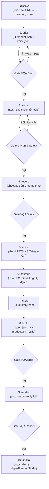

# 16 · Một lệnh: `kit make`

> Tự động hoá toàn bộ quy trình sản xuất video marketing demo sản phẩm (TikTok / Reels / Shorts 9:16) từ URL webapp và mục tiêu (goal), tương thích với mọi mô hình AI agent (`agy`, `codex`, `claude`).

---

## 1. Giới thiệu

`kit make` là lệnh trung tâm gói gọn toàn bộ tinh hoa sản xuất của `ai-marketing-video-kit`:
- **Một lệnh duy nhất:** Nhận web app URL + mục tiêu → sản xuất video MP4 hoàn thiện kèm dự án HyperFrames Studio sẵn sàng để tinh chỉnh bằng tay.
- **Tương thích đa mô hình:** Chạy qua Antigravity CLI (`agy:gemini-3.8-flash-high`), Codex CLI (`codex`), hoặc Claude Code (`claude:sonnet`).
- **Khả năng tiếp tục (Resumable):** Mọi công đoạn và kết quả được lưu trữ tại `<clip>/run.json`. Khi bị gián đoạn, lệnh tự động chạy tiếp từ công đoạn dở dang mà không phải làm lại từ đầu.
- **Vòng lặp kiểm tra chất lượng (Gate Loop):** Sau mỗi công đoạn quan trọng, Gate QA tự động bắt lỗi và gửi cấu trúc JSON lỗi (kèm `fix_hint`) ngược lại cho LLM sửa đổi (tối đa 3 lần).
- **Khai báo thuần túy (`story.json`):** Thay vì viết code Python thủ công, kịch bản dựng được đặc tả dưới dạng JSON chuẩn xác và chuyển đổi thành Story API qua `screendemo/story_json.py`.

---

## 2. Cú pháp dòng lệnh (CLI)

```bash
python tools/kit_make.py <url> --goal "..." --out <clip_dir> [tuỳ chọn]
```

### Các tham số:
| Tham số | Ý nghĩa | Mặc định |
|---|---|---|
| `<url>` | URL ứng dụng web cần làm video demo | *(bắt buộc khi bắt đầu mới)* |
| `--goal` | Mục tiêu truyền thông, sản phẩm, và thông điệp video | `""` |
| `--out` | Thư mục lưu trữ dự án clip đầu ra | *(bắt buộc)* |
| `--profile` | Hồ sơ thương hiệu và luật nội dung (`profiles/<tên>/`) | `stradevn` |
| `--len` | Thời lượng video mục tiêu (giây) | `90` |
| `--loop` | Bật chế độ video lặp vô tận (khung cuối zoom về đúng khung đầu) | `False` |
| `--model` | Engine và mô hình LLM điều khiển: `agy:gemini-3.8-flash-high`, `codex`, `claude:sonnet` | `agy:gemini-3.8-flash-high` |
| `--from` | Chỉ định công đoạn bắt đầu chạy (bỏ qua các công đoạn trước) | `discover` |
| `--only` | Chỉ chạy duy nhất 1 công đoạn rồi dừng lại | *(chạy tuần tự)* |
| `--studio-out` | Đường dẫn thư mục xuất cho HyperFrames Studio | `D:/Projects/video-studio/<profile>/<clip>-full` |
| `--cdp` | Cổng Chrome DevTools Protocol để điều khiển quay | `9333` |

Ví dụ:
```bash
# Sản xuất video giới thiệu tính năng tra mã HS và tìm người mua hồ tiêu
python tools/kit_make.py https://tools.stradevn.com \
  --goal "Lô 24 tấn tiêu đi Chicago — ai mua?" \
  --out D:/Projects/stradevn-video/clips/05-gioi-thieu-090411 \
  --profile stradevn --loop --len 65 --model agy:gemini-3.8-flash-high

# Chỉ chạy bước biên kịch (dry run)
python tools/kit_make.py https://tools.stradevn.com \
  --goal "Demo hồ tiêu" --out D:/agent-cache/ORCH/test-brief --only brief
```

---

## 3. Quy trình 10 công đoạn (Pipeline Stages)



### Chi tiết từng công đoạn:
1. **`discover`**: Dùng `screendemo/discover.py` điều khiển Chrome cổng 9333 trích xuất toàn bộ dữ liệu bảng, số liệu thống kê, và selector vào `<clip>/inventory.json`.
2. **`brief`**: LLM đọc `inventory.json` và phân tích mục tiêu. Chọn Hook gây tò mò cực độ (công thức thư viện hook), lập danh sách cảnh, ý đồ thị giác, và kịch bản giọng đọc chi tiết theo chuẩn đạo diễn.
3. **`shots`**: LLM sinh kịch bản thao tác `shots.json` chọn mục tiêu NGUYÊN VĂN từ facts. Hệ thống tự động quét kiểm tra an toàn (chặn các nút Tạo chiến dịch, Bắt đầu truy xuất, gửi email).
4. **`record`**: Chạy `screendemo/shoot.py` quay tự động các cảnh thao tác, tạo các mốc `marks.json` và ảnh contact sheet `sheet.jpg`.
5. **`voice`**: Đạo diễn giọng đọc Gemini TTS (`gemini-3.1-flash-tts-preview`, giọng `Puck` nam miền Bắc). Thu 2 takes cho câu Hook và CTA, chấm điểm qua `tts_qa.py` và chọn bản tốt nhất. Tự động đọc lại các câu bị cờ (tối đa 2 lần).
6. **`sources`**: Tự động tìm kiếm nguồn âm thanh không tương tác qua `tools/audio_web.py` (ưu tiên web catalog đã lọc bản quyền thương mại → thư viện nhạc AI Lyria → Freesound/Jamendo/Openverse).
7. **`story`**: LLM tạo kịch bản dựng khai báo `story.json` ghép các cụm lời thoại vào đúng mốc thời gian của bản quay.
8. **`build`**: Gọi `screendemo/story_json.py` và `produce.py --build` dựng file `index.html` và tính toán `cues.json`.
9. **`render`**: Render MP4 hoàn chỉnh với âm thanh chuẩn -14 LUFS bằng `produce.py --only full`.
10. **`studio`**: Đóng gói dự án thành HyperFrames chuẩn qua `tools/to_studio.py` để người dùng và agent có thể mở chỉnh sửa trực tiếp trên giao diện Studio.

---

## 4. Quản lý trạng thái và Resumable (`run.json`)

Mỗi clip sở hữu một file `run.json` theo dõi tiến độ:
```json
{
  "url": "https://tools.stradevn.com",
  "goal": "Lô 24 tấn tiêu đi Chicago",
  "profile": "stradevn",
  "len": 65,
  "loop": true,
  "model": "agy:gemini-3.8-flash-high",
  "created_at": "2026-11-10T04:20:00Z",
  "updated_at": "2026-11-10T04:35:00Z",
  "stages": {
    "discover": {"status": "done", "finished_at": "..."},
    "brief": {"status": "done", "finished_at": "..."},
    "shots": {"status": "done", "finished_at": "..."},
    "record": {"status": "running", "started_at": "..."}
  },
  "current_stage": "record"
}
```

Khi chạy lại lệnh mà không có cờ `--from` hoặc `--only`, hệ thống tự động tìm công đoạn đầu tiên chưa hoàn thành và chạy tiếp.

---

## 5. Kịch bản khai báo `story.json` (`schemas/story.schema.json`)

Thay vì code Python phức tạp, `story.json` mô tả toàn bộ cấu trúc video:
```json
{
  "version": "1.0",
  "title": "StradeVn · 24 tấn tiêu đi Chicago",
  "sfx_defaults": {
    "whoosh": "assets/src/sfx-whoosh.mp3",
    "pop": "assets/src/sfx-pop.mp3",
    "ink": "assets/src/sfx-ping.mp3"
  },
  "bgm": {
    "file": "assets/src/bgm.mp3",
    "volume": 0.16,
    "loop": true,
    "fade_in": 0.05,
    "fade_out": 0.15
  },
  "scenes": [
    {
      "id": "C1",
      "type": "screen",
      "rec": "s1",
      "r0": ["cang", 0.5],
      "r1": "khoanh-xong",
      "items": [
        {"line": "V1", "i": 0, "j": 2, "at": ["cang", 0.5]},
        {"line": "V1", "i": 2, "j": 3, "at": ["khoanh-xong", -0.2], "hint": 1.2}
      ],
      "badge": "24 TẤN · VŨNG TÀU → CHICAGO · AI MUA?",
      "tail": 0.25,
      "start_zoomed": true,
      "fade": false,
      "sfx": [
        {"at": 0.0, "file": "assets/src/sfx-impact.mp3", "vol": 0.7}
      ]
    },
    {
      "id": "C9",
      "type": "logo_end",
      "item": {"line": "V9", "i": 0, "j": 5},
      "name": "StradeVn",
      "tagline": "Tìm khách xuất khẩu bằng dữ liệu thật",
      "url": "tools.stradevn.com"
    }
  ]
}
```

Đã chứng minh thực tế trên bản sao Clip 05 (`D:/agent-cache/ORCH/c05`): biên dịch lại từ `story.json` đạt thời lượng **chính xác 97.41s** (trùng khớp 100% với file `story.py` thủ công).

---

## 6. Luật An Toàn và Đạo Diễn Giọng Nói Bắt Buộc

1. **Luật an toàn:**
   - Tuyệt đối không bấm các nút phát sinh chi phí hoặc hành động thật: *"Tạo chiến dịch"*, *"Bắt đầu truy xuất"*, *"Gửi email"*. Hệ thống tự động chặn và báo lỗi nếu `shots.json` chứa các thao tác này.
2. **Chuẩn giọng nói:**
   - Luôn sử dụng `gemini-3.1-flash-tts-preview` với profile giàu biểu cảm (Sales mentor chia sẻ kinh nghiệm).
   - Từng câu có `direction` riêng biệt theo nhịp cảm xúc.
   - Thẻ cảm xúc CHỈ dùng tiếng Anh ngắn (`[short pause]`, `[excited]`). Không dùng thẻ tiếng Việt.
   - Số viết bằng chữ tiếng Việt trong `text` và viết số trong `caption`.
   - Tên thương hiệu đọc chuẩn: *"Strade vi-en"*.
